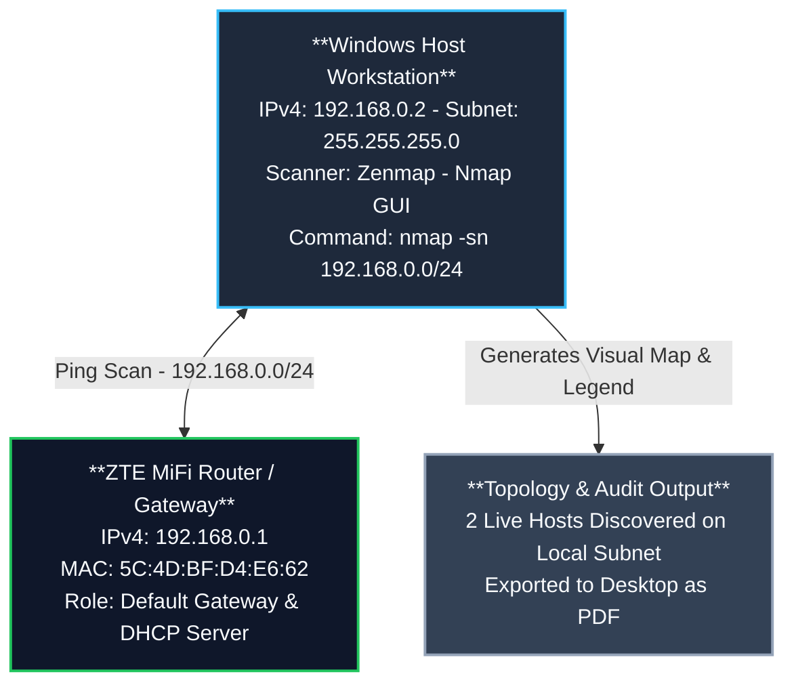

# NETWORKWALKS-B084-WK2-PM5-NETWORK-SCANNING-WITH-ZENMAP


<div align="center">

#  🛡️ Penetration Testing Lab: Active Network Scanning with Zenmap

**Subnet Mapping, Endpoint Enumeration & Topology Visualization with Zenmap**
</div>


<p align="center">


---

## 📋 Project Overview
**Zenmap** is the official cross-platform Graphical User Interface (GUI) for **Nmap (Network Mapper)**, widely used by cybersecurity professionals, network administrators, and ethical hackers for network discovery and security auditing.

In this lab (**Week 2 | Project Module 5**), active network scanning was performed on a Windows workstation to inspect local interface settings (`ipconfig`), discover responsive devices across the **`192.168.0.0/24`** LAN subnet using ICMP/ARP ping sweeps (`nmap -sn`), enumerate IPv4 and hardware MAC addresses, and export a visual network topology map in PDF format.

---

## 🎯 Objectives
* **Install & Configure Zenmap:** Deploy Zenmap alongside the Npcap packet-capture driver on Windows to enable active network probing.
* **Identify Local Network Boundaries:** Inspect host network adapters via `ipconfig` to determine the local IPv4 address (`192.168.0.2`), subnet mask (`255.255.255.0`), and target CIDR range (`192.168.0.0/24`).
* **Enumerate Active Endpoints:** Execute a subnet-wide **Ping Scan** (`nmap -sn 192.168.0.0/24`) to identify live hosts, count active devices, and resolve hardware MAC addresses and vendor OUIs.
* **Visualize & Export Network Topology:** Generate a graphical network topology map with the legend enabled and export the output as a PDF report.

---

## 💡 Purpose of the Lab
The purpose of this laboratory is to practice the **active scanning and network discovery phase** of a penetration testing engagement. After gathering external intelligence during reconnaissance, an analyst maps internal or local network segments to identify live endpoints, verify gateway routing, detect unauthorized or rogue devices, and document network communication paths before conducting port or vulnerability assessments.

---

## 🏗️ Lab Architecture & Network Topology
The scan was executed from a **Windows Host Workstation** connected via Wi-Fi to a **ZTE Wireless Router / Gateway** on the `192.168.0.0/24` subnet:




### Architecture Breakdown
* **Scanning Workstation (`192.168.0.2`):** Windows PC running **Zenmap** as Administrator with **Npcap** to send ICMP echo and ARP discovery probes across all 256 addresses in `192.168.0.0/24`.
* **Gateway Device (`192.168.0.1`):** ZTE MiFi router acting as the default gateway and DHCP server, responding to discovery probes with its hardware MAC identifier (`5C:4D:BF:D4:E6:62`).
* **Local Subnet Scope:** The scan mapped the active devices directly reachable on the `192.168.0.0/24` wireless subnet, identifying 2 responsive endpoints.


---


## 🛠️ Lab Tasks & Execution (Step-by-Step)

### Task 1: Download & Install Zenmap on Windows PC
* **Objective:** Install Zenmap (the official Nmap GUI) along with the required packet capture driver on the Windows workstation.
* **Action Taken:** Downloaded the official Windows setup executable from [nmap.org/download.html](https://nmap.org), ran the installer as Administrator, accepted the license agreement, and installed both **Zenmap (GUI Frontend)** and **Npcap**.


---


### Task 2: Find Local IP Address & LAN Subnet
* **Objective:** Determine the workstation's active IPv4 address, subnet mask, and target LAN subnet in CIDR notation.
* **Commands Executed:**
  First, `ipconfig` was executed in Windows Command Prompt to view the wireless adapter's IPv4 address (`192.168.0.2`) and subnet mask (`255.255.255.0`). Because `ipconfig` displays the subnet mask rather than the CIDR subnet prefix directly, `netsh` was run to cleanly isolate the `"Wi-Fi"` interface configuration and display the exact LAN subnet prefix:
 
 
 
 ```cmd
  ipconfig
```
* **Observed `ipconfig` Output (`Wireless LAN adapter Wi-Fi`)**
* **Connection-specific DNS Suffix:** *(blank)*
* **Link-local IPv6 Address:** `fe80::3235:3894:facd:b71b%8`
* **IPv4 Address:** `192.168.0.2`
* **Subnet Mask:** `255.255.255.0`
* **Default Gateway:** `192.168.0.1`


(Note: As shown in the screenshot, ipconfig also listed several disconnected virtual and secondary adapters—Local Area Connection, OpenVPN Connect DCO Adapter, Local Area Connection* 1, Local Area Connection* 2, and Bluetooth Network Connection—and displayed the Subnet Mask rather than the CIDR subnet prefix, which is why netsh interface ip show addresses "Wi-Fi" was used right after to display Subnet Prefix: 192.168.0.0/24.)


 
 
 ```cmd
  netsh interface ip show addresses "Wi-Fi"
  ```
* **Observed Output & Findings (`Configuration for interface "Wi-Fi"`):**
  * **DHCP Enabled:** `Yes`
  * **IP Address (Local IPv4):** `192.168.0.2`
  * **Subnet Prefix / LAN Subnet:** `192.168.0.0/24` (`mask 255.255.255.0`)
  * **Default Gateway:** `192.168.0.1`
  * **Gateway Metric / InterfaceMetric:** `0` / `50`


---

### Task 3: Find the List of Live Hosts/PCs in the IP Subnet
* **Objective:** Perform an active host discovery sweep across the local subnet to enumerate responsive devices.
* **Action & Command Executed:** Launched **Zenmap** as Administrator, entered `192.168.0.0/24` in the **Target** field, selected the **Ping scan** profile, and clicked **Scan**:
  ```bash
  nmap -sn 192.168.0.0/24
  ```
* **Live Hosts Discovered:**
  * `192.168.0.1` — Default Gateway / ZTE Wireless Router
  * `192.168.0.2` — Local Windows Host Workstation


---

### Task 4: Count the Number of Live Hosts in the Subnet
* **Objective:** Identify the total number of active devices responding within the scanned `/24` range.
* **Answer:** **2 live hosts** are active on the subnet (`256 IP addresses scanned`).

---

### Task 5: Identify the IP Addresses of the Live Hosts
* **Objective:** List the exact IPv4 addresses of every active endpoint discovered during the scan.
* **Answer:**
  * `192.168.0.1`
  * `192.168.0.2`

---

### Task 6: Identify the MAC Addresses of the Live Hosts
* **Objective:** Record the hardware Media Access Control (MAC) address and vendor OUI for each discovered host.
* **Answer:**
  * **`192.168.0.1` (Gateway / Router):** `5C:4D:BF:D4:E6:62` *(ZTE Corporation)*
  * **`192.168.0.2` (Local Windows PC):** Verified via `ipconfig /all` under **Wireless LAN adapter Wi-Fi** *(Physical Address)*

---

### Task 7: Display & Save the Output Topology in PDF Format
* **Objective:** Generate a visual network map with the legend enabled and export it to the Desktop as a PDF document.
* **Action Taken:** Switched to the **Topology** tab in Zenmap, toggled **Legend** on to review host and connection indicators, clicked **Save Graphic**, selected **PDF (`*.pdf`)** as the file format, and saved `Zenmap1.pdf` to the Desktop.


---
## 💡 Key Takeaways & Defensive Insights
* **Rapid Asset Inventory:** Even a lightweight, non-intrusive ping sweep (`nmap -sn`) quickly maps active devices, response latency, and hardware vendors via MAC OUI resolution.
* **Subnet Visibility:** Scanning the local `192.168.0.0/24` range confirmed the active gateway (`192.168.0.1`) and local scanning workstation (`192.168.0.2`) as the two responsive hosts on the network.
* **Defensive Recommendations:**
  * Conduct periodic internal Nmap sweeps to inventory connected endpoints and detect unauthorized or rogue MAC addresses on the LAN.
  * Configure host-based firewalls to restrict unnecessary ICMP echo replies on sensitive internal endpoints.


---

## 📂 Repository Structure
```text
├── README.md
├── network_topology.pdf
└── screenshots/
    ├── 1_Nmap download.png
    ├── 2_nmap file setup.png
    ├── 3_nmap choose components.png
    ├── 4_nmap choose install location.png
    ├── 5_npcap click install.png
    ├── 6_zenmap click on finish and open.png
    ├── 7_Open CMD & run ipconfig.png
    ├── 7b_Subnet prefix via netsh.png
    ├── 8_Zenmap scan.png
    ├── 9_Zenmap topology 1.png
    ├── 10_Zenmap topology 2.png
    └── 11_Zenmap quiz.png
```

```


---

## 🏆 Lab Assessment & Quiz Verification
After completing all practical scanning and topology export tasks, the official **NetworkWalks Zenmap Network Scanning (Practice Lab)** assessment was completed with a perfect score.

* **Assessment Name:** Zenmap Network Scanning (Practice Lab)
* **Platform:** [NetworkWalks Academy](https://networkwalks.com/zenmap-network-scanning-practice-lab/)
* **Score Achieved:** **100%**
* **Status:** Completed & Verified

### Quiz Completion Proof


## 🛠️ Problem Encountered & Solutions

* **Problem Encountered (Virtual Adapter Clutter & CIDR Prefix):** Running `ipconfig` displayed numerous disconnected virtual adapters (`vEthernet (WSL)`, `VirtualBox Host-Only`, and `OpenVPN`) alongside the physical Wi-Fi adapter, and displayed the decimal subnet mask (`255.255.255.0`) rather than the CIDR network prefix required by Zenmap.


* **Solution Applied:** Executed `netsh interface ip show addresses "Wi-Fi"` in Command Prompt to isolate the active wireless interface and directly retrieve the exact CIDR subnet prefix (`192.168.0.0/24`).


---

## 🔐 Security & Ethical Use
This laboratory and repository are intended strictly for educational and authorized research purposes only. All network scanning activities were conducted within the authorized [NetworkWalks](https://networkwalks.com) lab scope and on personally owned local network devices. Unauthorized scanning or exploitation of external systems is illegal.

## 🔗 Tools & Resources
* **Primary Environment:** Windows Host Workstation ([NetworkWalks](https://networkwalks.com) Week 2 | Project Module 5)
* **Scanning & Enumeration Suite:** [Nmap / Zenmap GUI](https://nmap.org), Windows Command Prompt (`ipconfig`)
* **Official Documentation:** [Nmap Reference Guide](https://nmap.org) | [Zenmap User's Guide](https://nmap.org)

## 👤 Author
**Anderson Edaiyo Uzezi**  
Cybersecurity Professional B084  
LinkedIn: https://www.linkedin.com/in/anderson-edaiyo-bab74117b


